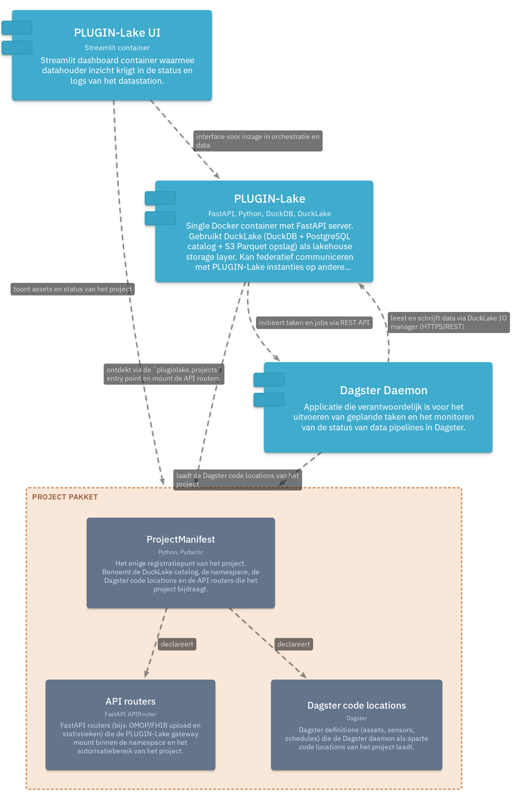

# Deploying a station

A pluginlake **station** is the standardized platform (PostgreSQL, Dagster, the FastAPI gateway, and the dashboard) plus one or more **projects** that provide the domain logic. The platform is the same everywhere; each deployment differs only in which projects it runs. This guide shows how projects are onboarded and how to bring a station up.

## How onboarding works

Projects plug into a station through a single entry point — no files are copied or edited by hand (ADR-009).



1. A project package declares a `ProjectManifest` and registers it on the `pluginlake.projects` entry-point group in its `pyproject.toml`:

    ```toml
    [project.entry-points."pluginlake.projects"]
    ehds-demo = "ehds_demo.manifest:manifest"
    ```

   The manifest names the project's DuckLake catalog, its asset namespace, and the Dagster code locations and API routers it contributes.

2. The operator lists the projects to deploy in a `pluginlake.toml` station config.

3. `pluginlake up --dev` reads that config, installs the listed projects into the standardized images at container start, and core **discovers** them via the entry point — mounting their code locations in Dagster and their routers on the API gateway automatically.

!!! note "Projects and the production stack"
    The production stack (released images, `pluginlake up` without `--dev`) does not install projects yet: its containers have a read-only root filesystem and no build tools.
    `pluginlake up` refuses a `pluginlake.toml` with `[[projects]]` and points to `--dev`.

Because wiring happens at install time through the entry point, the platform image never has to know about any specific project ahead of time.

## The station config

`pluginlake.toml` is the operator-owned deployment surface. Each project is either a local checkout (`path`, for development) or a pinned install spec (`source`, for production):

```toml
[station]
endpoint_url = "http://localhost:8000"

[monitoring]
enabled = true          # start Prometheus and exporters (compose profile `monitoring`)
station_id = "ds-001"

[[projects]]
name = "ehds-demo"
# Dev: a local sibling checkout, mounted and editable-installed into the images.
path = "../pluginlake-ehds-demo"

# [[projects]]
# name = "ehds-demo"
# Prod: a pinned spec, no local checkout needed.
# source = "pluginlake-ehds-demo @ git+https://github.com/plugin-healthcare/pluginlake-ehds-demo@v0.1.0"
```

Exactly one of `path` or `source` must be set per project. See `src/pluginlake/deploy/config.py` for the full schema.
The `[monitoring]` section is optional and described in the [monitoring guide](monitoring.md).

## Bring the station up (production)

A station runs the released, digest-pinned images; no source checkout is needed.
The compose stack and its configuration ship inside the package (`pluginlake/deploy/stack/`), and the release workflow writes the image digests into it (see [security](security.md)).

```bash
uv tool install pluginlake          # or: pip install pluginlake==<version>
mkdir station && cd station         # the station directory: config, env file and secrets
```

The station directory holds:

| Path | Contents |
|------|----------|
| `pluginlake.toml` | Station config (below) |
| `.env.production` | Non-secret settings; template `pluginlake/deploy/stack/templates/env.production.example` in the installed package |
| `.env.monitoring` | Optional: Prometheus remote-write URL and username; template `env.monitoring.example` |
| `secrets/` | One file per password, see [secrets](docker.md#secrets) |

`pluginlake up` prints the template path when `.env.production` is missing.
Create the secrets (directory `0700`, files `0644`):

```bash
install -d -m 700 secrets
for name in postgres_password dagster_pg_password ducklake_pg_password; do
  openssl rand -base64 32 | tr -d '\n' > "secrets/$name"
done
# With [monitoring]: postgres_exporter_password. With lineage: marquez_db_password.
chmod 644 secrets/*
```

The images come from `ghcr.io/plugin-healthcare/pluginlake/` and the base images of Postgres from `dhi.io`; log in to the registries that are not public for your node (see [security](security.md#registries)).
Then start the station:

```bash
pluginlake up -d
```

`pluginlake up` checks the secrets, sets the image references from the package's images lock (`stack/images.json`, every image pinned by digest) and runs `docker compose` with the station directory as project directory.
A build without released images (a source checkout, or a wheel built outside the release workflow) refuses to start the production stack.
Once it is healthy:

| Service | URL | Reachable from |
|---------|-----|----------------|
| API docs (Swagger) | <http://localhost:8000/docs> | all interfaces |
| API health | <http://localhost:8000/health> | all interfaces |
| Dashboard (Streamlit) | <http://127.0.0.1:8501> | host loopback only |
| Dagster (pipelines and assets) | <http://127.0.0.1:3000> | host loopback only |
| Prometheus (only with `[monitoring] enabled = true`) | <http://127.0.0.1:9090> | host loopback only |

The web UIs have no authentication, so they listen on loopback only; use an SSH tunnel (`ssh -L 3000:127.0.0.1:3000 user@station-host`).
PostgreSQL, the Dagster code server and the Marquez API are not published at all.

Stop the station with `pluginlake down` (add `-v` to also remove the volumes, which deletes the databases and uploaded data).

## Bring the station up (development)

From a core checkout, with the projects available at the paths in `pluginlake.toml`:

```bash
uv run pluginlake up --dev -d
```

This builds the dev images from source, starts the stack, installs the configured projects, and wires their contributions.
The dev stack publishes the dashboard on <http://localhost:8501> and Dagster on <http://localhost:3000>, and PostgreSQL on `127.0.0.1:5432` for `just dev-local`.

Verify that the configured projects conform to the plugin contract and are wired correctly:

```bash
uv run pluginlake verify
```

Stop the dev station (add `-v` to also remove volumes):

```bash
uv run pluginlake down --dev
```

`pluginlake down` stops every optional service (dashboards, lineage and monitoring), also when they are switched off in `pluginlake.toml`.

## Lineage with Marquez (optional)

A station can run [Marquez](https://marquezproject.ai) as the receiver for OpenLineage events (ADR-007). Switch it on in `pluginlake.toml`:

```toml
[station]
lineage = true
```

`pluginlake up` then also starts the `lineage` compose profile: the Marquez API, the Marquez web UI and a dedicated PostgreSQL database (separate from the Dagster database).

| What | Where |
|------|-------|
| OpenLineage endpoint (inside the compose network) | `http://marquez:5000/api/v1/lineage` |
| Marquez web UI (host loopback only) | <http://127.0.0.1:3001> |

Marquez has no authentication, so the UI is bound to `127.0.0.1` and is not reachable from other machines. Administrators on a remote station use an SSH tunnel:

```bash
ssh -L 3001:127.0.0.1:3001 user@station-host
```

With lineage on, `pluginlake up` also sets `OPENLINEAGE_URL=http://marquez:5000` and `OPENLINEAGE_NAMESPACE` on the service that runs the Dagster code (`dagster` in dev, `dagster-code-server` in production). Core then registers the `openlineage_sensor`, which the Dagster daemon runs after every successful run. It sends one OpenLineage event per materialized asset to Marquez: upstream assets as inputs, the DuckLake table as output, and the schema, row count and column lineage from the asset metadata. Events contain no data values, only job and dataset metadata. Projects do not need to register anything.

Give each node its own namespace, so jobs from different stations stay apart:

```toml
[station]
lineage = true
lineage_namespace = "ds-local-001"
```

Dataset names in Marquez are the DuckLake table names (for example `ducklake.omop.person`), the same as in the catalog API. Sending is best-effort: if Marquez is unreachable, the sensor logs a warning and skips that run's events, and the run itself is unaffected.

Lineage data is stored in the `marquez-db-data` volume and survives `pluginlake down` and restarts; `pluginlake down -v` removes it.
In production the database password is the secret file `secrets/marquez_db_password`; `MARQUEZ_DB`, `MARQUEZ_DB_USER` and `MARQUEZ_WEB_PORT` can be set in `.env.production`.
In dev they are set in `deploy/compose/.env` (`MARQUEZ_DB_PASSWORD` too); see `deploy/compose/.env.example`.

## Onboarding a new project

Scaffold a conformant project package, implement its assets and routers, then add it to `pluginlake.toml`:

```bash
uv run pluginlake init my-project
```

Add a `[[projects]]` entry pointing at the new checkout (or its pinned source) and run `pluginlake up --dev` again. The `pluginlake-ehds-demo` repository is a complete worked example of a project package.
