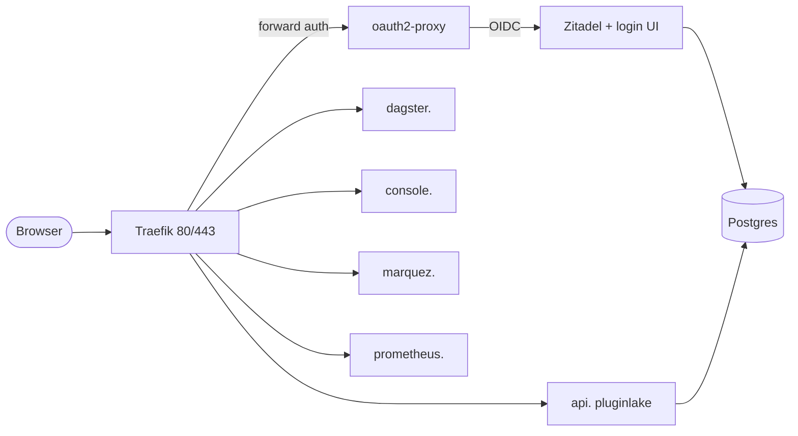

# Docker guide

This is the background and reference page for how pluginlake runs in Docker: the containers, the ways to run them, where each setting lives, and how secrets and data are handled.
To start a node, follow [Getting started](getting-started.md).

## Container architecture

The production compose (`deploy/compose/docker-compose.yaml`) has one container per concern.

| Group | Containers | Image |
|-------|-----------|-------|
| Platform | `pluginlake` (API), `dagster-webserver`, `dagster-daemon`, `dagster-code-server`, `dashboard-datastation` (the console) | Built from `deploy/docker/` (`pluginlake.Dockerfile`, `dagster-webserver.Dockerfile`, `ui.Dockerfile`) |
| Data | `postgres` (Dagster metadata and DuckLake catalog), `pluginlake-db-init` (roles and databases) | `dhi.io/postgres:17-alpine3.24`, built init image |
| Lineage | `marquez`, `marquez-web` | `marquezproject/marquez` and `marquez-web` 0.51.1 |
| Monitoring | `prometheus`, `postgres-exporter`, `cadvisor` (Compose only, can be switched off) | Upstream images pinned by digest, see the [monitoring guide](monitoring.md) |
| Edge | `traefik`, `oauth2-proxy`, `zitadel-init`, `zitadel-api`, `zitadel-login`, `zitadel-groups-hook`, `pluginlake-init`, `starting-page` | See [Edge](#edge) |

Prometheus and Marquez are core components and always start with the production compose.
`[station]` and `[monitoring]` in `pluginlake.toml` set the lineage namespace, the station label, cAdvisor and the retention.

The development compose (`docker-compose.dev.yaml`) is smaller.
`dagster.dev.Dockerfile` replaces the Dagster webserver, daemon and code server with 1 container running `dagster dev`, the API runs with `uvicorn --reload`, and source code is mounted into the containers.
Monitoring and lineage are compose profiles (`monitoring`, `lineage`), and there is no edge.
The dashboard is built by `ui.Dockerfile`.

## Running options

| Recipe | Compose file | What it does |
|--------|-------------|--------------|
| `just up` | `docker-compose.yaml` | Runs `pluginlake setup`, then builds and starts the production stack |
| `just down` | `docker-compose.yaml` | Stops the production stack, the data stays in `PLUGINLAKE_HOME` |
| `just setup` | none | Prepares the data folder, secrets, `compose.env` and the local certificate without starting anything |
| `just dev-up` | `docker-compose.dev.yaml` | Platform development stack with the dashboards |
| `just dev-up-headless` | `docker-compose.dev.yaml` | The same without the dashboards |
| `just dev-down` | `docker-compose.dev.yaml` | Stops the development stack, all profiles |
| `just dev-local` | none | Titanic example without Docker, see the [Titanic tutorial](../development/titanic-tutorial.md) |
| `just smoke-test-full` | dev and smoke override | Starts an isolated stack, runs the smoke test and removes it with its volumes |

Production images are self-contained, with no source mounts.
The build context is always the project root, for example `docker build -f deploy/docker/pluginlake.Dockerfile -t pluginlake .`.

## Where settings live

| What | Production | Development |
|------|-----------|-------------|
| Node settings (domain, first admin, projects, monitoring) | `pluginlake.toml` | Compose environment in the dev compose file |
| uid, gid, data folder and domain for compose | `${PLUGINLAKE_HOME}/compose.env`, written by `pluginlake setup` | Not needed |
| Secrets | One file per secret in `${PLUGINLAKE_HOME}/secrets/` | `deploy/compose/.env`, mounted as the same secret names |
| Extra non-secret settings for a project | `[[projects]]` in `pluginlake.toml` | `deploy/compose/.env.containers` or `PLUGINLAKE_ENV_FILE` |
| Data | Bind mounts below `PLUGINLAKE_HOME` | Docker volumes |

## Projects and database provisioning

The dev images share the entrypoint `deploy/docker/entrypoint.sh`, which installs the packages in `PLUGINLAKE_PROJECTS` (whitespace-separated `uv pip install` arguments) before the service starts.
The production images do not run it.
Projects register through the `pluginlake.projects` entry point, so the core finds their code locations and routers without importing project code.

```bash
PLUGINLAKE_PROJECTS="-e /opt/projects/my-project"                                  # local editable checkout
PLUGINLAKE_PROJECTS="my-project@git+https://github.com/org/my-project@v1.2.3"      # pinned spec
```

Projects are installed with `--no-sources`, so their `[tool.uv.sources]` table is ignored.
The dev Dagster container and DuckLake create their own databases on start when they do not exist yet.

## Smoke test

The smoke test checks the core stack without any project: the API and Dagster answer, the core routers respond, every code location loads and a file upload through `POST /api/v1/ingest` is stored.
Project pipelines are tested in their own repositories.

```bash
just smoke-test        # Run against an already running stack
just smoke-test-full   # Start an isolated stack, run the test, tear it down (removes volumes)
```

`smoke-test-full` uses its own throwaway config in `deploy/compose/smoke.env` and `smoke.secrets.env`, so it does not depend on your `.env`.
It publishes the same host ports as the dev stack, so stop `just dev-up` first.

## Hardened base images

All Dockerfiles use hardened images from `dhi.io/` (Python, Postgres and `uv`) instead of the default Docker Hub images.
They are rebuilt with security fixes, carry no unnecessary packages and come with an SBOM, which reduces the attack surface in healthcare environments.
The `-dev` variants include compilers and are only used in build stages.

Pulling them requires a Docker Hub account and a one-time `docker login dhi.io`.
Not all images in the [catalog](https://hub.docker.com/hardened-images/catalog) are free.

## Multi-stage builds

Production Dockerfiles build in 2 stages.
The first stage uses the `-dev` Python image to run `uv sync --frozen --no-dev` and compile dependencies.
The second stage is the minimal runtime image, which only receives `/app/.venv` and `src/` from the first, so it has no compilers, pip or uv.
That makes images smaller, leaves fewer vulnerabilities (build tools are the most common source of CVEs) and speeds up deploys.

Dev Dockerfiles use a single stage, because they need the full toolchain for hot reload, debugging and `dagster dev`.

## Edge

The production compose publishes only the ports 80 and 443 of Traefik.
Traefik terminates TLS and sends every application host through oauth2-proxy forward auth, with Zitadel as identity provider.



| Host | Service | Protected |
|------|---------|-----------|
| `<domain>` | Redirects to `console.<domain>` | No |
| `auth.<domain>` | Zitadel and its login UI | No (it is the sign-in) |
| `api.<domain>` | pluginlake API | Yes |
| `dagster.<domain>` | Dagster webserver | Yes |
| `console.<domain>` | Start page: Streamlit console with the links to the other applications | Yes |
| `marquez.<domain>` | Marquez web | Yes |
| `prometheus.<domain>` | Prometheus | Yes |

`[node] domain` in `pluginlake.toml` sets the domain.
A domain below `.localhost`, such as the default `pluginlake.localhost`, resolves to the local machine in browsers, so `just setup` creates a certificate for it with [mkcert](https://github.com/FiloSottile/mkcert) in `tls/` of the data folder.
Install mkcert first; setup runs `mkcert -install` once so browsers trust it, and oauth2-proxy trusts the same root CA.
Firefox and Chrome need `certutil` for that (`libnss3-tools` on Debian and Ubuntu), so install it before the first `just setup`, or run `mkcert -install` again afterwards.

Traefik reads its certificate from `tls/tls.yaml` in the data folder.
For a real domain, put your own `tls.yaml` with `certFile` and `keyFile` entries (paths below `/tls`) and the certificate files there; setup does not overwrite it.

On first start `pluginlake-init` waits for Zitadel, creates the project and the OIDC application with the Management API and writes the oauth2-proxy configuration to the `bootstrap` folder, so there are no manual steps.
The first admin is `ZITADEL_ADMIN_USERNAME` with the generated password in `secrets/zitadel_admin_password`.
Zitadel always forces a new password at the first login.
All other users, passwords and access are managed in Zitadel.
The choice of Zitadel, with Keycloak as the fallback, is described in [ADR-011](../decisions/adr-011-identity-provider.md).

All protected hosts share one oauth2-proxy and one session cookie on `.<domain>`, so you sign in once, for example on the console, and open every application without signing in again.
All applications behind the proxy therefore trust the same session.
oauth2-proxy refreshes the session with Zitadel every 5 minutes, so a removed role takes effect within those minutes.
The session at the edge ends after 30 minutes without use, and at the latest 12 hours after signing in, because `pluginlake-init` sets the lifetime of refresh tokens in Zitadel to 12 hours.
oauth2-proxy then sends the user to Zitadel.
After 30 minutes without use Zitadel signs them in again without a password, and after 12 hours they enter their password again, because `pluginlake-init` also limits the sign-in at Zitadel to 12 hours.
This limit is set on the default login policy of the instance; an organization that gets a login policy of its own in the Zitadel console needs the same check lifetimes.
A silent sign-in just before the 12 hours end gives a new refresh token, so in that case a session lasts at most almost 24 hours.
A browser tab that polls in the background, such as the Dagster UI, keeps its session in use, so for that tab only the 12 hours apply.
Change the 12 hours with `PLUGINLAKE_BOOTSTRAP_SESSION_MAX_AGE` (for example `PT8H`) on `pluginlake-init`, and the 30 minutes with `--cookie-expire` of oauth2-proxy in a local override file.

Access is per application.
`pluginlake-init` creates a Zitadel project role for each application (`api`, `console`, `dagster`, `marquez`, `prometheus`) and gives the first admin all of them.
A user only opens an application when they have the role with that name, otherwise Traefik answers 403, and the sidebar of the console only shows the links the user has a role for.
Grant roles to other users as user grants on the project `pluginlake` in the Zitadel console.

The roles reach oauth2-proxy as a `groups` claim.
While Zitadel builds the token and the userinfo, it calls the service `zitadel-groups-hook` (an Actions v2 call target that `pluginlake-init` creates), which answers with the roles of the project `pluginlake`.
The target fails closed: when the hook is down or the signature check fails, Zitadel issues no token and nobody can sign in.
The hook checks the signature with a key that `pluginlake-init` writes to the `bootstrap` folder.
Zitadel blocks targets in private address ranges by default, so `zitadel-api` has `ZITADEL_HTTPCLIENT_DENYLIST` set to the default list without `172.16.0.0/12`, the range of the Docker networks.
Adjust that list when your Docker networks use another private range.
In Zitadel the loginname is `<username>@<organisation>.auth.<domain>`, for example `admin@zitadel.auth.pluginlake.localhost`.

Traefik uses the file provider and has no access to the Docker socket.
Postgres and the other databases are only on the internal network `db-net`.
Nuts and DPoP endpoints are not routed yet; they will bypass forward auth when the Nuts work is done (#127).

## Environment variables and secrets

### Overview

Configuration is passed as environment variables.
Passwords are Docker Compose secrets, mounted as files under `/run/secrets/`, so they are not in `docker inspect` or any env file.
Only Dagster has its storage password in the environment, because `dagster.yaml` can only read it from `DAGSTER_PG_PASSWORD`.

### Secrets

The dev compose fills its secrets from the compose-only `deploy/compose/.env`.
The production compose uses one file per secret in `${PLUGINLAKE_HOME}/secrets`, generated by `pluginlake setup`.
Compose bind-mounts these files with their host owner and mode, and every container runs as the host user that owns them (mode `0400`), so nobody else can read them.

How each service reads its secret:

| Service | Secret file | How |
|---------|-------------|-----|
| pluginlake API, code server, Dagster (DuckLake) | `ducklake_pg_password` | pydantic `secrets_dir` |
| Dagster | `dagster_pg_password` | `pluginlake.deploy.dagster_env` exports it as `DAGSTER_PG_PASSWORD` for the Dagster process |
| postgres, postgres-exporter | `postgres_password`, `postgres_exporter_password` | `*_FILE` variables of the image |
| Zitadel | `zitadel_masterkey`, `zitadel_config.yaml`, `zitadel_admin_password`, `zitadel_steps.yaml` | `--masterkeyFile`, `--config`, `--steps` |
| Zitadel login UI, Marquez | `zitadel_cookie_secret`, `marquez_db_password` | The entrypoint exports it from the file |

`pluginlake secrets list --home <data folder>` shows the name, origin and presence of every secret without values, and exits with 1 when a secret is missing.
`pluginlake secrets get <name> --home <data folder>` prints one value and logs the access without the value.
`pluginlake setup` generates every secret that does not exist yet.
A secret manager can supply a value instead by writing the same file before the first `just up`, and then owns its rotation.

The Zitadel master key encrypts the Zitadel database and is never rotated, so keep `secrets/zitadel_masterkey` in the backup of the data folder.

Environment variables and `.env` take precedence over secret files, so keep passwords out of every env file a container loads.
Extra non-secret settings (e.g. for a project) can go in `deploy/compose/.env.containers`, or another file selected with `PLUGINLAKE_ENV_FILE`.

### Production: `pluginlake.toml` and the data folder

The production compose has no defaults and no env files.
Node settings (domain, first admin name) are in the `[node]` section of `pluginlake.toml`, and fixed names such as the database roles are constants in the compose file.

| What | Where | Created by |
|------|-------|------------|
| Node settings | `[node]` in `pluginlake.toml` | You |
| uid, gid, data folder and domain for compose | `${PLUGINLAKE_HOME}/compose.env` | `pluginlake setup`, run by `just up` |
| Secrets | `${PLUGINLAKE_HOME}/secrets/` (one file per secret, mode `0400`) | `pluginlake setup`. The secrets, their kind and the services that mount them are listed in `src/pluginlake/deploy/secrets.toml` |
| Database roles and databases | Postgres | `pluginlake-db-init` (`python -m pluginlake.deploy.init_databases`) |

Compose reads the host user, the data folder and the domain before any container runs.
`just up` therefore first runs `pluginlake setup` in a container as the host user, without network and with a read-only root file system.
It creates the folders and the secrets that do not exist yet and writes `compose.env`, and it can also run on the host (`uv run pluginlake setup --home .pluginlake`).
Existing secrets are never overwritten, so `just up` is safe to run again.
Do not rotate secrets by deleting files: removing a database password file without changing it in Postgres locks the service out.

`pluginlake-db-init` is the only service besides Postgres that uses the Postgres superuser.
It creates a role and a database per service (`dagster`, `ducklake`, `zitadel`) and a read-only `pg_monitor` role for postgres-exporter, each with its own generated password.

### Data folder and host user

All containers run as the host user and keep their data in bind mounts below `PLUGINLAKE_HOME` (default `.pluginlake`; set the environment variable before `just up` to use another folder).
There are no named volumes, so `docker compose down -v` and `docker volume prune` do not remove data.
Back the folder up as a whole.

```text
.pluginlake/
├── compose.env    # uid, gid, home and domain for compose
├── secrets/       # mode 0700
├── bootstrap/     # one folder per consumer (admin, login, hook, proxy) with tokens and oauth2-proxy config, mode 0700
├── ca/            # root certificate of a local node, trusted by oauth2-proxy
├── postgres/      # database cluster
├── prometheus/    # metrics
├── data/          # DuckLake storage and Dagster state
└── passwd         # passwd entry for the host user, mounted into the Postgres containers
```

Run this on Linux.
Docker Desktop on macOS maps the ownership of bind mounts, which makes Postgres refuse its data folder.

### Dagster instance config and logs

The dev stack uses `config/dagster/dagster.yaml` and production uses `dagster.production.yaml`.
They differ only in compute logs: production uses `NoOpComputeLogManager`, because capturing stdout/stderr needs `tail`, which the hardened images lack.
In production, `context.log` messages go to Postgres and the Dagster UI, and stdout/stderr of steps only to the `dagster-code-server` container log, so do not print data there.

The production compose rotates every container log (5 files of 10 MB each); change the limits in the `x-logging` anchor if a station needs another retention.

### Development: `deploy/compose/.env`

Compose loads `.env` from the directory of the compose file for interpolation and as the source of the secrets.
Containers never load it.
Copy it from `deploy/compose/.env.example`.

```dotenv
POSTGRES_USER=dagster
POSTGRES_PASSWORD=dagster
```

The dev stack uses the Postgres superuser for every service and mounts the one `postgres_password` secret under the names the settings read (`dagster_pg_password`, `ducklake_pg_password`).
The root `.env` is only for `just dev-local` (no Docker).

Compose secrets are not encrypted at rest, so protect them with file permissions.
Kubernetes and Swarm mount secrets as files too, so the same `/run/secrets/<name>` files work with the platform's secret store.
